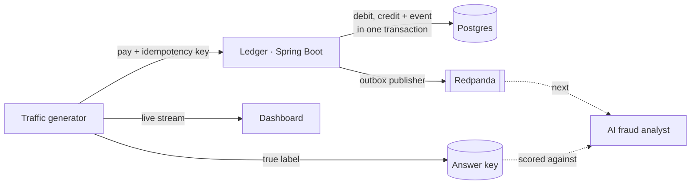
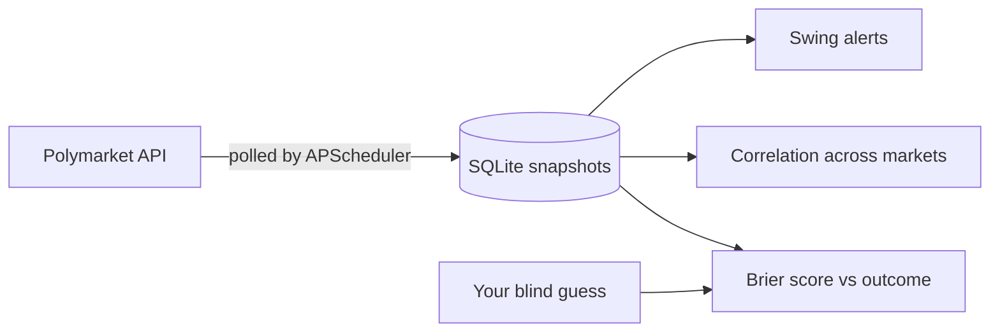
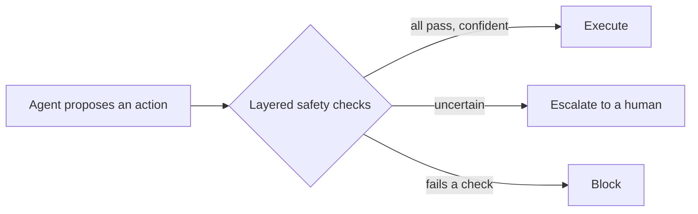

**SWE/DA enthusiast · Newcastle University CS grad · Fintech, fraud and AI safety · Interested in ML/AI **

---

I'm Kevin, a Computer Science grad from Newcastle. Most of my projects end up being about money in some way: a small bank ledger, an Airbnb price model, a tool for tracking prediction markets. My dissertation was on how to stop AI agents from making payments they shouldn't.

Right now I'm mostly working on Clearhouse (below).

## Quick quiz

A few questions that came up while building these. Have a guess before opening the answer.

<b>Q1.</b> I say a market has a 70% chance of YES and it resolves NO. What's my Brier score? (lower is better)

 

**0.49.** Brier score is (forecast − outcome)², so (0.7 − 0)² = 0.49.
If I'd said 50% I'd have scored 0.25, and 10% would have scored 0.01. [Split Decision](https://github.com/KevST14/SplitDecision) works this out for your own guesses over time.

<b>Q2.</b> You tap "pay", lose signal, and the app sends the request again. How many times should you be charged?

 

**Once.** Each payment has an *idempotency key*, so a retry gets back the original transfer instead of creating a new one. In [Clearhouse](https://github.com/KevST14/clearhouse) I test this by sending the same request 20 times from 8 threads at once. Only one goes through.

<b>Q3.</b> When pricing a London Airbnb, what helps the model more: <i>where</i> it is, or <i>how the listing is written</i>?

 

**Where it is.** Adding location features (distance to stations, parks and places to eat) took R² from 0.62 to 0.65. The listing text was only worth about £1–2 a night. You can try it in the [live demo](https://london-rent-reality-check-jikdwpaozdee8hvjjccgaa.streamlit.app).

<b>Q4.</b> An AI agent is 60% sure a payment is legit. Should it send the money?

 

**Not by itself.** This is what my dissertation was about. The agent's action goes through several separate checks, and if it isn't confident enough, a human makes the call instead. There's a diagram further down.

## Projects

<h3>Clearhouse</h3>

-E4405F?style=flat-square&logo=apachekafka&logoColor=white)

A small version of a bank's back office that I'm building to learn how payments actually work. There's a double-entry ledger (amounts stored in pence, idempotency keys, row locking), and every transfer gets published to Redpanda through a transactional outbox. A traffic generator simulates 120 customers and 22 shops spending money, and you can trigger fraud on top of that: card testing, a money mule ring, or an account takeover. Each one shows up as a different pattern in the dashboard.

<picture>
  <source media="(prefers-color-scheme: dark)" srcset="https://raw.githubusercontent.com/KevST14/clearhouse/main/docs/dashboard-dark.png">
  
</picture>

- After every test, each transfer has to net to zero and each currency has to sum to zero. The tests run against a real Postgres using Testcontainers, not a mock.
- Optimistic locking kept failing on busy accounts in an 8-thread test, so I switched to pessimistic locks taken in a fixed order. CI on Linux also caught a timestamp bug (nanoseconds vs microseconds) that never showed up on my Mac.
- Next I'm adding a dbt/DuckDB pipeline over the event stream, then an AI fraud analyst that gets scored on precision and recall against the generator's answer key.

**[View repo](https://github.com/KevST14/clearhouse)**

<h3>Split Decision</h3>

Pulls prices from Polymarket on a schedule, stores snapshots in SQLite and flags markets where the odds move a lot. You can also enter your own probability before seeing the market price, and once the market resolves you get a Brier score, so you can see whether you'd have beaten it.

**[View repo](https://github.com/KevST14/SplitDecision)**

<h3>Rent Reality Check</h3>

Predicts a fair nightly price for a London Airbnb listing using Inside Airbnb and OpenStreetMap data, and uses SHAP to show which features pushed the price up or down. I used spatial cross-validation so the model is always tested on areas it hasn't seen. Without that it can memorise neighbourhoods and look better than it really is.

Results on held-out areas:

| R² | Median error | Mean error |
|:---:|:---:|:---:|
| **0.72** | **22%** | **~£60/night** |

**[Try the live demo](https://london-rent-reality-check-jikdwpaozdee8hvjjccgaa.streamlit.app)** · **[View repo](https://github.com/KevST14/london-rent-reality-check)**

<h3>Patch Notes</h3>

A news dashboard I built for myself. It pulls stories from Hacker News, Lobsters, GitHub and about a dozen news sites, then groups articles about the same story into one card. The grouping uses TF-IDF similarity on headlines with extra weight on names, so three outlets covering one earnings call get merged but two unrelated "critical flaw" stories don't.

It also learns from what I keep, skip and save, and shows the reason each story is in my feed. There's a trending section for terms that suddenly appear across more than one source, compared against each source's normal baseline so a fresh install doesn't flag everything. I added a swipe-through catch-up mode and a weekly headline quiz too, mostly because they were fun to build. No sign-up, no API keys and no tracking.

**[View repo](https://github.com/KevST14/patchnotes)**

<h3>SpendSync</h3>

A personal finance app for tracking income and spending, with category budgets, savings goals and recurring transactions. Built on Next.js and Prisma, with Zod validating everything that comes into the REST API.

**[View repo](https://github.com/KevST14/SpendSync)**

<h3>Dissertation</h3>

*Design and Evaluation of a Layered Safety Architecture for Autonomous Financial Execution Agents* (2026)

The idea is that you shouldn't rely on one model always getting it right. Every action the agent proposes goes through a set of independent checks. If they all pass and the agent is confident, it goes ahead. If one fails, it's blocked. If the agent isn't sure, a human decides.

## Tools I use

## Contributions

<picture>
  <source media="(prefers-color-scheme: dark)" srcset="https://raw.githubusercontent.com/KevST14/KevST14/output/github-contribution-grid-snake-dark.svg" />
  
</picture>

---

<i>If you want to talk about any of this, my email and LinkedIn are at the top.</i>

